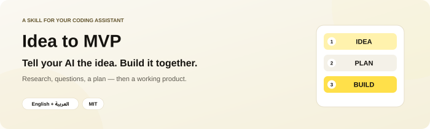
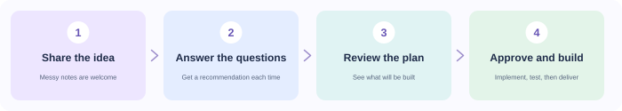
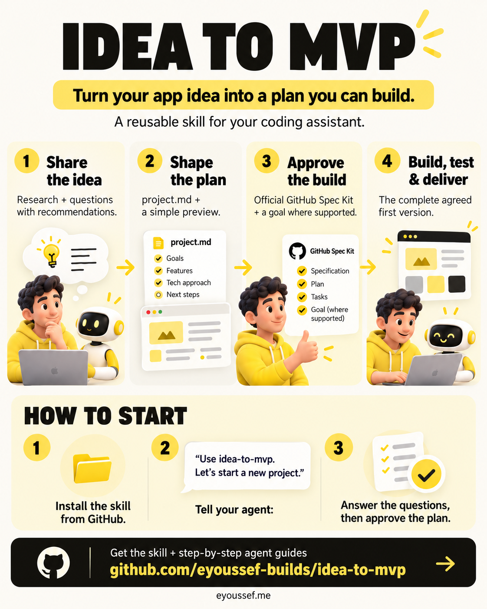
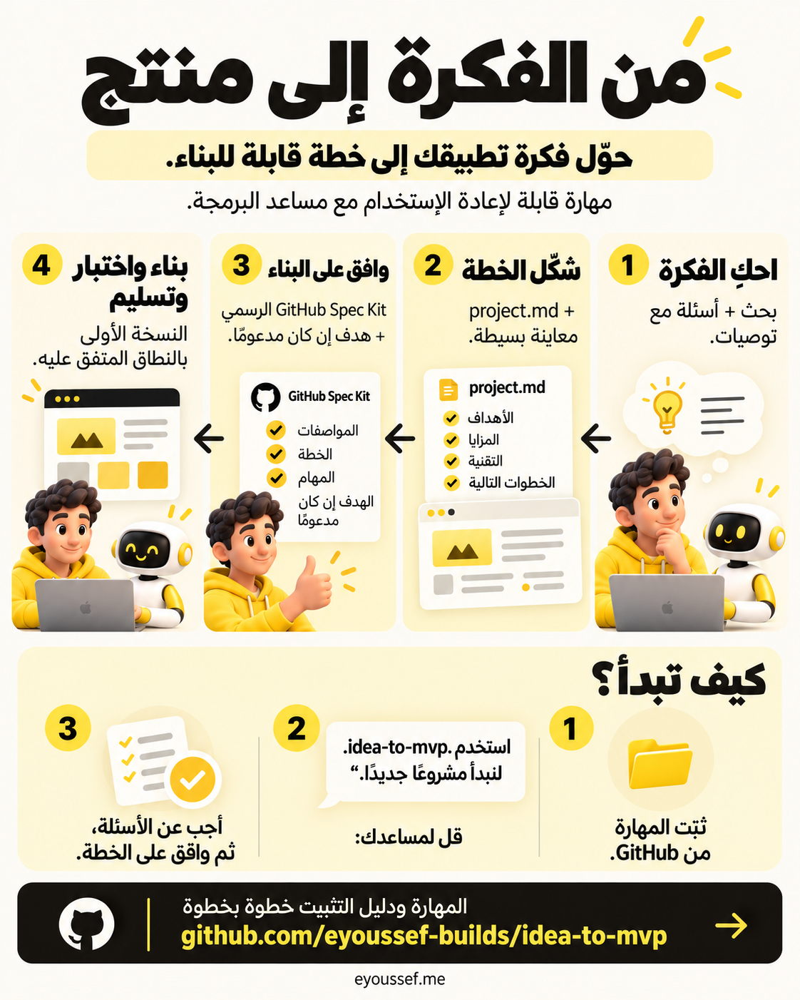

<p align="center">
  
</p>

<p align="center"><a href="README.ar.md"><b>اقرأ هذا الدليل بالعربية</b></a> · <a href="#installation">Install</a> · <a href="#first-use">Try it</a> · <a href="#questions">Questions &amp; answers</a> · <a href="#share">Share</a></p>

<p align="center">
  <a href="LICENSE"></a>
  <a href="docs/agent-installation.md"></a>
  
</p>

---

## 👋 What is Idea to MVP?

You have an idea for an app. You tell your AI, and it starts writing code. Then you realize you never agreed on **who the app is for, what it should do, or how people will use it**.

**Idea to MVP gives your AI a way to work through the idea with you, before and during the build.**

1. You **describe your idea**, in your own words.
2. The assistant **researches it and asks questions**, with a recommendation for each one.
3. You **review a clear plan**, then say when you want it built.
4. It follows the agreed plan through **building, testing and the authorized release**.

<p align="center"></p>

It is for people starting a software project: a first-time founder, a solo builder, or someone with an idea they cannot quite explain yet. **You do not need a finished brief.** Rough notes, links and “I want something like this, but…” are enough to start.

### What can it help with?

| You want to… | The assistant helps you… |
| --- | --- |
| 🔎 Understand the idea | Research the problem, alternatives and references you share. |
| 💬 Make decisions | Answer useful questions, each with a recommendation and a reason. |
| 📝 Put it into words | Create `project.md`: what the product is, how it works and what to build. |
| 👀 See it before building | Review a simple screen preview and an example of the main output. |
| 🧩 Organize the build | Use the official GitHub Spec Kit workflow for specifications and tasks. |
| 🛠️ Build the first version | Implement the complete agreed experience and test important behavior. |
| 🔄 Come back tomorrow | Resume from saved decisions and the current workflow state. |

**MVP** means your first useful version. For example, a meal-planning app that takes ingredients and produces a plan people can follow.

---

<a id="installation"></a>

## 📥 Install it — step by step

**You need:** a coding assistant that can read files. You might already use Codex, Claude Code, Cursor, Gemini CLI or another agent. A **skill** is simply a folder of instructions you add to that assistant.

### The easiest way: let your assistant install it

1. **Open your coding assistant.** Use a session that can download and save files.
2. **Copy and send this message:**

   ```text
   Install idea-to-mvp from https://github.com/eyoussef-builds/idea-to-mvp.
   Read the installation guide and inspect the skill first. Install the complete
   skills/idea-to-mvp folder in this agent's supported personal skill directory.
   Preserve any existing customized copy. Tell me when it is ready and how to use it.
   ```

3. **Read any download or file-write permission request** from your agent. Installation needs permission to save the skill folder.
4. **Check it is ready.** Ask: “Can you see the idea-to-mvp skill? Tell me how to start it.”

🎉 **Installed? Jump to [your first project](#first-use).**

### Prefer to copy the folder yourself?

1. **[Download the ZIP](https://github.com/eyoussef-builds/idea-to-mvp/archive/refs/heads/main.zip).**
2. **Unzip it.** On Mac, double-click it. On Windows, right-click → **Extract All…**.
3. Open the extracted folder → **skills**. Inside is the complete **idea-to-mvp** folder.
4. Follow the [guide for your agent](docs/agent-installation.md) to put that folder in the right place.
5. Reopen your agent if the skill does not appear, then ask it to use **idea-to-mvp**.

The guide covers **15 agents**, with macOS/Linux and Windows instructions, plus an explicit-read fallback for other assistants. You only need to install it for the assistant you actually use.

---

<a id="first-use"></a>

## 🚀 Your first project

### 1. Tell it the idea

Open a folder for your new project and start your assistant there. In **Codex**, send:

```text
Use $idea-to-mvp. Let's start a new project.
I want an app that helps people plan meals from ingredients they already have.
Research the idea, then interview me with your recommendations before building.
```

The meal app is a **fictional example**. Replace it with your idea. In Claude Code, use `/idea-to-mvp`; for other agents, follow their installation guide or ask for the skill by name.

### 2. Answer the questions

The assistant researches, then asks about the people you want to help, their journey, product rules, design and price.

> 💬 **“I don't know which option to choose.”** That is why every question comes with a recommendation and a short reason. You can accept it, change it, or ask the assistant to explain.

You can say **“all recommended, except…”** to accept the suggestions it just presented. It usually asks a few related questions at a time. If an important question is still unanswered, it keeps asking—there is no fixed interview limit.

### 3. Review what you are going to build

The assistant writes **`project.md`** and prepares a small preview of the main experience. You read it and say what needs changing. You can skip the preview if you prefer.

| In the plan | In everyday words |
| --- | --- |
| Customer and problem | Who needs this, and what are they trying to do? |
| Journeys and outputs | What does someone click, and what useful thing do they get? |
| Rules and pricing | What is allowed, what is paid, and how do limits work? |
| Scope | What will be in this first version? |
| Acceptance checks | What must work before we call it finished? |

### 4. Say when you want it built

When the plan looks right, send:

```text
Approved. Use official GitHub Spec Kit, set a goal if this agent supports it,
and build the MVP in project.md. Complete the agreed scope, test it, and prepare
the agreed delivery. Ask me about any unresolved account, budget or deployment decisions.
```

The assistant checks the actual tools and access, organizes the build with **GitHub Spec Kit**, implements the agreed product and verifies it. It does not need you to repeat approval at every routine step. New material decisions still come back to you.

### 5. Try the result

Walk through the product and review the checks and handoff. Agree on whether delivery means **ready for you to add specifically deferred provider credentials** or **fully activated with the required real-provider checks completed**. The [delivery guide](skills/idea-to-mvp/references/delivery.md) explains both.

<details>
<summary><b>🔧 Curious how the workflow stays organized?</b></summary>

- `research/` holds source findings and the interview/decision record.
- `project.md` is the accepted product definition.
- `docs/workflow-state.md` records the current phase, approvals, questions and next action.
- Official Spec Kit generates its own specifications, plan, contracts and tasks. The assistant checks the installed version and uses the integration for your agent.
- A native goal is used when authorized and available. Otherwise the objective and checks are saved in the workflow state. A saved file does not create background execution.

Read the [interview guide](skills/idea-to-mvp/references/interview.md), [Spec Kit handoff](skills/idea-to-mvp/references/spec-kit.md) or [official Spec Kit quickstart](https://github.github.io/spec-kit/quickstart.html) for the details.

</details>

---

## 🔒 Privacy in one minute

- This repository contains **reusable instructions and blank templates**. No real project briefs or private chats are included.
- Your project's files stay in the workspace you choose. Publishing them is a separate decision.
- Your assistant and any connected services use their own permissions and data settings.
- Put private preferences in your installed `references/local-profile.md`, and keep secrets out of chat and Git.

Full details: [Privacy guide](docs/privacy.md).

---

<a id="questions"></a>

## ❓ Questions & answers

<details>
<summary><b>Is this another AI app I need to pay for?</b></summary>

No. It is an instruction folder for your existing coding assistant. The skill is MIT-licensed and free to use. Your agent subscription, API usage and any project services keep their own costs.

</details>

<details>
<summary><b>Do I need to know how to code?</b></summary>

You can begin with an idea and plain-language answers. Building and operating the result still needs an agent with development tools, and your decisions about accounts, budgets and release. The assistant explains the missing setup when it matters.

</details>

<details>
<summary><b>What if I only want help shaping the idea?</b></summary>

Say so. You can stop after research, the interview or the plan. Accepting interview recommendations does not by itself start a new build phase.

</details>

<details>
<summary><b>What is Spec Kit? Must I install it first?</b></summary>

It is GitHub's separate toolkit for turning written requirements into a build plan. You can research and interview without it. At build handoff, the assistant checks the official setup for your agent. This repository does not bundle Spec Kit.

</details>

<details>
<summary><b>Can I use it with my existing project?</b></summary>

Yes, when you want to resume this workflow or shape a substantial product direction. It reads existing decisions and resumes rather than overwriting them. Ordinary bug fixes or small features do not need a new discovery interview.

</details>

<details>
<summary><b>The skill does not appear. What should I check?</b></summary>

Install the complete folder in your agent's supported directory. Check that `SKILL.md` is directly inside `idea-to-mvp`, reopen or reload the agent, then invoke it explicitly. See [troubleshooting](docs/agent-installation.md#troubleshooting).

</details>

<details>
<summary><b>How do I update or remove it?</b></summary>

Download the new version, compare it with your installed copy, and preserve your modifications and private profile before replacing files. To remove it, delete only the installed `idea-to-mvp` folder or use your agent's uninstall control. Your project files are separate.

</details>

<details>
<summary><b>Can I share it or use it for client work?</b></summary>

Yes. The [MIT license](LICENSE) allows use, modification and sharing, including commercial use, with its copyright/license notice retained. Share [this repository](https://github.com/eyoussef-builds/idea-to-mvp) so others can find the guides and updates.

</details>

---

<a id="share"></a>

## 🖼️ Share this skill

Two infographics explain what the skill does and how to start, with its GitHub link included.

[English image](docs/images/infographic-en.png) · [Arabic image](docs/images/infographic-ar.png) · [Copyable bilingual captions](docs/share.md)

<p align="center">
  <a href="docs/images/infographic-en.png"></a>
  <a href="docs/images/infographic-ar.png"></a>
</p>

---

## 🛠️ For developers

```text
skills/idea-to-mvp/
  SKILL.md       Main workflow
  references/    Interview, Spec Kit and delivery guidance
  assets/        Blank product and workflow templates
  agents/        Codex metadata
docs/            Installation for 15 agents and privacy guides, in both languages
```

The workflow adapts to the host's available tools. It does not install accounts, grant spending authority or require a particular cloud provider. The supporting files explain the exact handoffs and delivery checks.

## 🤝 Support & contact

Questions or ideas? [Open an issue](https://github.com/eyoussef-builds/idea-to-mvp/issues) in English or Arabic. For private matters, email **[hello@eyoussef.me](mailto:hello@eyoussef.me)**.

**Created by [eyoussef-builds](https://github.com/eyoussef-builds)** · ✉️ [hello@eyoussef.me](mailto:hello@eyoussef.me) · 🌐 [eyoussef.me](https://eyoussef.me) · [MIT license](LICENSE)
